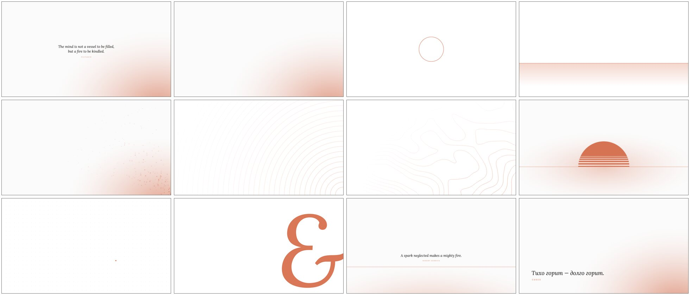

# ember light

the light twin of [ember](https://github.com/gloomyweather/omarchy-ember-theme):
a black-and-white [omarchy](https://omarchy.org) theme with one orange accent.

pure white, pure black and `#d97757`. the orange is a shade darker in text and syntax
so it stays readable on white. same wallpapers, redrawn for daylight.



## install

```sh
omarchy theme install https://github.com/gloomyweather/omarchy-ember-light-theme
omarchy theme install https://github.com/gloomyweather/omarchy-ember-theme   # the dark one
```

then pick it in the omarchy menu (style → theme), or run `omarchy theme set ember-light`.
`omarchy theme update` pulls new versions later.

## what's inside

- `colors.toml`. omarchy builds the terminal, hyprland, bar, neovim, btop and the rest from it.
- twelve wallpapers, 1920×1080, in `backgrounds/`. switch them in style → background.
- an orange boot and unlock logo. turn it on in style → unlock.
- yaru icons.

## palette

```
background  #ffffff    foreground  #000000
accent      #d97757    muted       #737373
surface     #f5f5f5    selection   #e5e5e5
border      #e5e5e5    active      #d97757
```

syntax uses darker oranges (`#c6613f`, `#b5502f`, `#8a3b22`) for contrast on white.
red and green are kept, muted, so diffs still read as diffs.

the wallpapers and the script that draws them live in the [ember](https://github.com/gloomyweather/omarchy-ember-theme#wallpapers) repo.

## license

mit. the wallpapers are part of it. the quotes are by plutarch and robert herrick (public domain).
the unlock logo is omarchy's, recolored.
